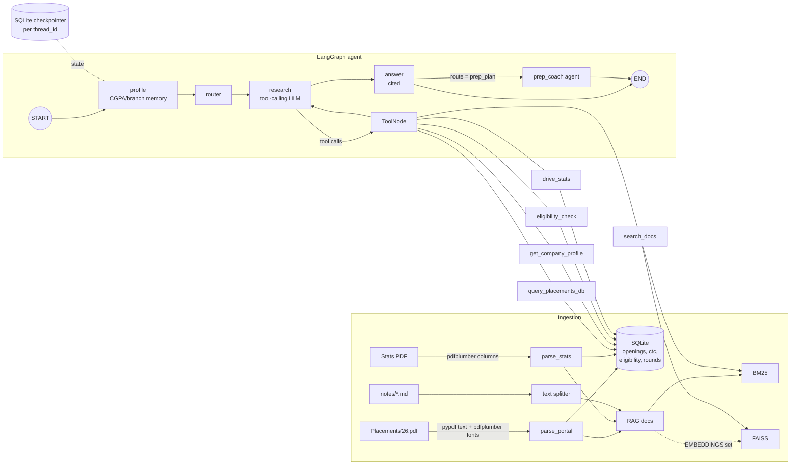

# Placement Intel Agent (LangGraph + RAG)

An agent that answers placement questions over IIT (BHU)'s 2025-26 placement documents: which companies
come first, what each role pays, who is eligible, how the drive went day by day, and how to prioritise prep.

Illustrative output (company names and figures are placeholders; the real placement data is not published):


https://github.com/user-attachments/assets/a6561a4d-4e69-4971-9040-0424a6db6ea7


```
you> I have CGPA 9.7, CSE, strong in C++ - which companies should I prep for first, and what to study?

You are eligible for N openings (cgpa=9.7, branch=cse, course=btech). By interview day -
Day 1: a, Day 2: b, Day 3: c, day not announced: d.
---
### Prep order - what comes first
**Day 1** - a eligible openings (top 8 shown)
- Day 1 (slot 0): Company A - Quantitative Researcher - XX LPA - cutoff 7.5 [S1]
- Day 1 (slot 0): Company B - Software Engineer - XX LPA - no cutoff [S2]
...
### What to study (general guidance - the documents have no OA patterns)
- **SDE / Software**: DSA in C++ (...), OOP, OS/DBMS/CN basics, LLD for SDE-1
...
Sources: [S1] <portal export>.pdf p.12 (#40)  [S2] <portal export>.pdf p.12 (#41) ...
```

## What it does

| Question type | Example | How it's answered |
|---|---|---|
| Structured filter / ranking | "Which companies came in Dec for SDE roles with CTC above 20 LPA?", "SDE roles above 40 LPA in <city>" | parameterised SQL over SQLite |
| One company | "What CTC does <company> offer for SDE?" | company profile tool (+ doc search) |
| Compare | "Compare <company A> vs <company B>" | profile tool once per company |
| Eligibility / prep order | "I have 9.7 CGPA, CSE - what should I prep for first?" | eligibility tool -> **prep-coach agent** |
| Drive statistics | "How many offers on Day 3?" | statistics-sheet tool |
| Free-text details | "Which company has a 2.5-year bond?" | hybrid retriever (BM25 + optional dense) |

Every answer cites its sources as `[S#] <file> p.<page> (#<card no.>)`.

## Data

| Source | Contents | Parsed into |
|---|---|---|
| `Placements'26.pdf` (87 pages, portal print) | 274 company/role cards: role, CTC & take-home per course, CGPA cutoff, courses, branches, backlogs, willingness deadline, interview slot (Day 1 = 1 Dec 2025, slots 0/1/2), location, remarks, JD file | `openings`, `ctc`, `eligibility` tables + 274 RAG docs |
| `Placement Statistics Till Day 5.pdf` | offers/profiles per phase (internship, PPO, Day 1..Day 4&5), companies per phase, and drive totals (offers, highest and average CTC) | `rounds`, `round_companies`, `summary` + 8 RAG docs |
| `data/raw/notes/*.md/.txt/.pdf` (optional) | anything you add: OA patterns, interview experiences, senior guides (file name = company) | chunked RAG docs |

The portal PDF is a printed web page, so company name and role are both plain wrapped lines. The parser uses
**font information** (company names are bold) via pdfplumber to split them, and handles cards broken across
pages. Interview day comes from the portal slot when announced (133 openings), otherwise from the statistics
sheet's day-wise company lists (40 more).

**Not in these documents:** OA patterns, interview rounds, questions asked. The agent says so instead of
guessing; drop notes into `data/raw/notes/` and re-run ingestion to add them.

## Architecture



- **Router / planner** - picks one of `company, compare, structured, eligibility, prep_plan, stats, semantic`.
- **Research node** - ReAct-style loop: the LLM calls tools (max 4 rounds), then hands off to the answer node.
- **Tools** - the LLM never writes SQL; it fills typed arguments and the tool builds a fixed, parameterised query.
- **Answer node** - writes the reply only from tool results and cites `[S#]` tags that map to file + page.
- **Prep coach** - a second agent that takes the eligible openings and builds a day-by-day prep order plus a
  study plan per role type (multi-agent handoff).
- **Memory** - CGPA / branch / course / preferred roles extracted from messages (or set via `PUT /profile`)
  persist per `thread_id` with LangGraph's SQLite checkpointer, so follow-ups like
  *"am I eligible for quant roles?"* reuse them.
- **Offline mode** - with `LLM_PROVIDER=none` the router and research steps use a deterministic rule planner
  and answers are rendered from templates. Same graph, same tools. Useful for cheap, reproducible evals and
  as a fallback when the LLM's routing output can't be parsed.

## Demo UI

```
uvicorn api:app
```
Open http://127.0.0.1:8000 for a simple chat page: a message box, answers rendered as markdown tables, a
collapsible source list, and the route, tools and latency under each answer. A sidebar lists
past chats; click one to reopen and continue it, or "New chat" for a fresh context (each chat has its own
memory: messages, CGPA/branch profile). Chats are stored by the LangGraph SQLite checkpointer
(`GET /threads`, `GET /history/{thread_id}`, `DELETE /threads/{thread_id}`). Markdown rendering uses
vendored copies of marked (MIT) and DOMPurify (Apache-2.0/MPL-2.0) in `web/vendor/`, so it works offline. The **LLM / Offline RAG** switch picks the mode per message:
Offline RAG uses the rule-based router and template answers (no LLM calls), LLM lets the model plan the tool
calls and write the answer. The LLM option is disabled when no `LLM_PROVIDER` is configured.
The API takes the same choice: `POST /chat {"message": "...", "thread_id": "...", "mode": "auto|llm|offline"}`.

## Quick start (Windows PowerShell)

```powershell
cd rag_project
python -m venv .venv
.venv\Scripts\activate
pip install -r requirements.txt

# put the two PDFs in data\raw\ (they are git-ignored)
python -m placement_agent.ingest.build      # ~30 s: parses PDFs, builds SQLite + index

python cli.py                                 # chat
python cli.py "Compare <company A> vs <company B>"  # one-shot
uvicorn api:app                               # chat UI at http://127.0.0.1:8000, API docs at /docs
python -m eval.run_eval --verify-gold         # evaluation
```

Use an LLM: copy `.env.example` to `.env`, set e.g. `LLM_PROVIDER=google_genai`, `LLM_MODEL=gemini-3.5-flash-lite`,
`GOOGLE_API_KEY=...`, and `pip install langchain-google-genai`. Each LLM call times out after `LLM_TIMEOUT`
seconds (default 45, one retry); if a call fails, that step falls back to the offline rules and a `[warn]`
line is printed, so an overloaded model never blocks an answer. Dense retrieval: set `EMBEDDINGS=huggingface:sentence-transformers/all-MiniLM-L6-v2`,
`pip install langchain-huggingface sentence-transformers`, then re-run ingestion.

### API

```
POST /chat                {"message": "...", "thread_id": "shuchita"}
     -> {answer, route, sources[{tag, source}], tools_used[{tool, args}], profile, latency_s}
GET  /profile/{thread_id}
PUT  /profile/{thread_id} {"cgpa": 9.73, "branch": "cse", "preferred_roles": ["sde"]}
GET  /health
```

### MCP server

`pip install mcp`, then `python mcp_server.py` exposes `query_placements`, `company_profile`, `eligibility`,
`drive_statistics` and `ask_agent` over stdio to any MCP client.

## Evaluation

`eval/qa.jsonl` (35 questions) and `eval/heldout.jsonl` (15 questions) are hand-written. They are git-ignored because they quote the internal documents; the runner and metrics are in the repo. Each item has the facts
the answer must contain (with alternatives such as `12,00,000|12 LPA`) and **evidence strings that are checked
against the raw PDF text** (`--verify-gold`), so gold answers don't depend on the parser being right.

Metrics: answer accuracy (all facts present, no forbidden ones), route accuracy, citation validity (cites
`[S#]` and every tag exists), retrieval hit@1 / hit@5 on the document-search questions, latency.

Results in **offline mode** (rule router, BM25 only, no LLM), measured in this build:

| Set | Answer acc. | Route acc. | Citation validity | Retrieval hit@1 / hit@5 | Latency p50 |
|---|---|---|---|---|---|
| Dev set, 35 Q (I fixed failures on this set) | 100% | 100% | 100% | 88.9% / 100% (9 Q) | ~10 ms |
| Held-out, 15 Q, **first run before any fixes** | 93.3% | 93.3% | 100% | 66.7% / 100% (3 Q) | ~10 ms |

Honest caveats: both sets are small and written by the same person who built the system. The dev number is
inflated by tuning. The held-out failures (branch list not shown, "Squarepoint Capital" matching "Capital One")
were fixed after that first run. LLM-mode numbers depend on your provider; run the eval with your `.env` and
record them (`eval/results_<provider>_<set>.json`).

## Project layout

```
placement_agent/
  config.py            env-driven settings (LLM, embeddings, paths)
  ingest/parse_portal.py   portal PDF -> records (font-aware header split, page-break recovery)
  ingest/parse_stats.py    stats PDF -> phases + companies (column positions)
  ingest/build.py          SQLite schema, role categories, RAG docs, notes loader
  retriever.py         BM25 + FAISS hybrid with reciprocal-rank fusion and metadata filters
  tools.py             5 tools (parameterised SQL, eligibility, stats, profile, search)
  rules.py             offline router/planner + profile extraction
  graph.py             LangGraph StateGraph, checkpointer, PlacementAgent.ask()
  prompts.py, formatting.py, llm.py
api.py  cli.py  mcp_server.py
eval/qa.jsonl  eval/heldout.jsonl  eval/run_eval.py
```

## Limitations

- Parser heuristics are tuned to this portal's print layout; a different export may need tweaks. 73 cards say
  "Refer Description" for CTC; 13 of those are recovered from the remarks text, the rest stay `null`.
- `role_category` is keyword-derived from the role title ("Multiple roles" when the card says "Refer JD").
- Non-INR offers (AED) are converted with a fixed rate only for ranking; the raw currency is always shown.
- CGPA cutoff `0.00` on the portal is treated as "no cutoff stated".
- Location filters match the city named in a card's location or remarks; about 96 of 274 cards name no
  location, so they never match a city filter.

## Data privacy

The placement PDFs are internal. `data/raw/`, `data/processed/` and eval results are git-ignored. The eval
files quote facts from the documents. Keep the repo private, or swap in anonymised data before publishing.
